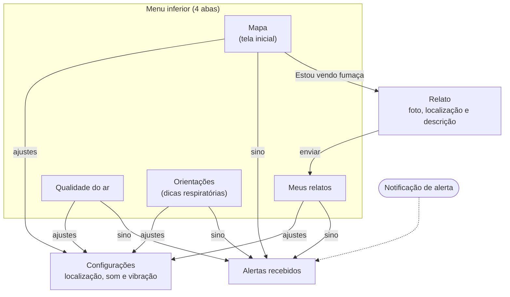

# Navegação do aplicativo

A navegação segue o protótipo de alta fidelidade e a seção "Navegação" de [`justificativas.md`](justificativas.md#4-navegação). No código, ela fica em `app/lib/core/router/`, com o pacote `go_router`.

## Fluxo entre as telas

## Rotas

| Rota | Tela | Tipo | Issue que implementa |
|---|---|---|---|
| `/mapa` | Home: card de qualidade do ar, atalho para os alertas, mapa de focos e botão "Estou vendo fumaça" | Aba (inicial) | #10 e #11 |
| `/relatos` | Meus relatos | Aba | #14 |
| `/qualidade-ar` | Qualidade do ar | Aba | #17 |
| `/dicas` | Orientações (dicas respiratórias) | Aba | #13 |
| `/relatar` | Relato de fumaça | Por cima do menu | #12 |
| `/alertas` | Alertas recebidos | Por cima do menu | #14 |
| `/configuracoes` | Configurações | Por cima do menu | #20 |

* **Abas:** ficam no menu fixo embaixo, ao alcance do polegar. Cada aba guarda a própria pilha de telas, e tocar na aba atual volta para o início dela.
* **Telas por cima do menu:** abrem com `context.push(...)` e têm botão de voltar. O relato esconde o menu para a pessoa focar no envio.
* **Alerta de proximidade em 2 toques:** tocar na notificação (ou no botão "Alertas de proximidade" da Home) abre os alertas, e tocar no alerta abre o mapa. A ligação com a notificação é da issue #22.
* **Sem tela de login:** a decisão está em `justificativas.md`. O relato é anônimo, e os relatos ficam salvos no celular.

As constantes das rotas ficam em `core/router/rotas.dart`. Use sempre essas constantes, nunca o texto do caminho.

## Tema

O tema fica em `app/lib/core/theme/`:

* `app_colors.dart`: a paleta de `justificativas.md` e o gradiente laranja → vermelho do mapa de calor.
* `app_theme.dart`: o tema claro de alto contraste. O app usa só o tema claro, que é o mais legível sob o sol.

Os testes em `test/core/theme/` garantem o contraste mínimo da WCAG (4,5:1, e 7:1 no texto principal) e a altura dos botões. Ao mudar uma cor, rode os testes.

A fonte **Manrope** do protótipo fica em `app/assets/fonts/`, nos pesos 400, 500, 600, 700 e 800, e vai junto com o app. Assim ela funciona offline, sem baixar nada da internet. Os arquivos vêm do repositório oficial [googlefonts/manrope](https://github.com/googlefonts/manrope) e usam a licença SIL Open Font License, que está em `app/assets/fonts/OFL.txt`.
